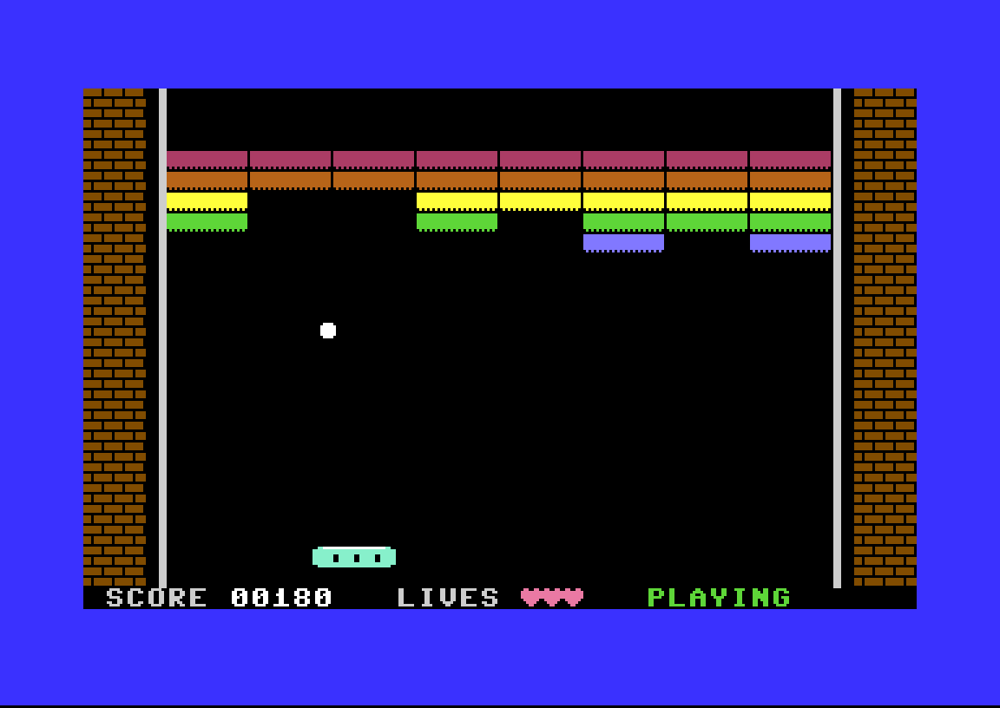
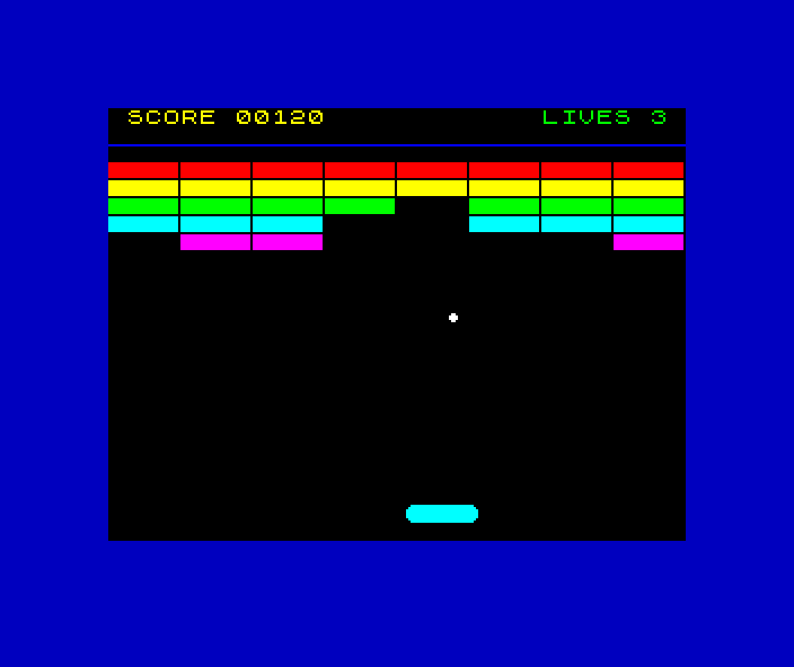

# Game Port Factory

A workflow and toolkit for **porting games from one system to another** (vintage computers,
consoles, DOS PCs), built so that AI agents can do most of the work and a machine check
proves each result. It started with 8-bit computers: an original game verified on three
CPUs, and *Fantasy World Dizzy* from the ZX Spectrum to the Tandy CoCo 2.

The premise: a port is never reusable, but the scaffolding around it is. This repo is that
scaffolding:

- **`gpf`**, an on-disk state machine for resumable, episodic projects: a stage model, a
  strategy-classification procedure, a task graph where every task carries a model tier and
  a verifier, and a handoff discipline that lets a cold session resume exactly where the last
  one stopped.
- **`gpfdiff`**, a differential harness that replaces the person watching two screens: it runs
  a port and an oracle in emulators, injects the same input, reads the game state out of RAM
  every step, and reports the first difference. The oracle is a reference model for a game you
  wrote, or the original binary itself, driven from outside, for one you did not.
- **Platform profiles as data** (`factory/platforms/`): ten so far, from the ZX81 and the NES to
  DOS PCs and the Dreamcast, used to plan the order of ports by what actually carries over.

**New here? Start with [`docs/GETTING-STARTED.md`](docs/GETTING-STARTED.md)** — a 30-minute
guided tour: build the tools, run the Brickfall demo on a C64 and a ZX Spectrum, break it on
purpose, and start your own port.

## Install

```bash
cargo build --release --manifest-path gpf/Cargo.toml
ln -sf "$PWD/gpf/target/release/gpf" ~/.local/bin/gpf
echo 'export GPF_ROOT=~/projects/game-port-factory' >> ~/.bashrc
```

`gpf` finds the repo by walking up to the `.gpf-root` marker, or via `$GPF_ROOT` when run
from elsewhere.

## How you actually use it

**You don't drive the CLI — you talk to Claude Code in this directory and it drives the
CLI.** `CLAUDE.md` loads automatically and carries the session protocol.

```
$ claude
> resume the dizzy-coco2 port
...
> wrap up
```

Your four jobs: **decide** the judgement calls, **supply** media you own, **approve**
installs and pulls, and **stop whenever you like** — the handoff makes that safe.

Full guide, including how to match work to the time you have: **`docs/OPERATING.md`**.

Commands worth knowing yourself:

```bash
gpf list                        # every port and where it stands
gpf status <slug>               # handoff note, blockers, next task
gpf plan c64,zxspectrum48,zx81  # target order, and what carries between them
gpf models                      # local models: installed, what fits, what to pull
```

## The three ideas

**1. Strategy classification decides cost.** Two questions — does source exist, is the
target at least as capable — pick between `source-port`, `recompile`, and `reimplement`,
which differ by orders of magnitude. Getting this wrong is the expensive mistake.
→ `docs/STRATEGY.md`

**2. Transfer between targets is per-axis, not one number.** Different artifacts travel
along different axes, so "the second port is cheaper" is true but useless without saying
*which parts*:

```
$ gpf plan c64,zxspectrum48,zx81
  c64 -> zxspectrum48: carries [raster, memory_tier]   # art + scope survive, code does not
  zxspectrum48 -> zx81: carries [cpu, storage]         # code survives, art does not
```

Two hops, two axes each, opposite axes. → `docs/SELF-IMPROVEMENT.md`

**3. Work routes by verifiability, not difficulty.** "Is there a cheap deterministic check
that proves this output correct?" — not "is this simple enough for a small model?" A weak
model that hits a wall returns confident wrong output, so the top tier is defined by the
*absence* of a verifier. → `docs/COST-MODEL.md`

## Layout

```
CLAUDE.md              agent session protocol — loaded automatically every session
docs/OPERATING.md      how to run a session; your job vs the agent's
docs/STAGES.md         the seven stages and their exit criteria
docs/STRATEGY.md       stage 2: the decision that determines project cost
docs/SELF-IMPROVEMENT.md  track 2: tools, recipes, dead ends, transfer axes
docs/COST-MODEL.md     tier routing, escalation, local models
.claude/agents/        tiered subagents: gpf-scout, gpf-grunt, gpf-builder
factory/platforms/     target capability profiles (data, not model recall)
factory/models.toml    local-model roster with roles and sizes
factory/tools/         promoted reusable tools (see factory/tools/README.md)
factory/recipes/       reusable decisions, each with its precondition
factory/escalations.log  which tasks were mis-tiered — routing feedback
games/<game>/recipe/   platform-neutral game definition, shared by all its targets
gpf/                   the state-machine CLI (Rust)
ports/<slug>/
  PORT.toml            manifest: game, platforms, stage, strategy, handoff note
  tasks.toml           task graph with dependencies, tier and verifier per task
  NOTES.md             durable findings — formats, addresses, dead ends and why
  SESSION-LOG.md       append-only history
  source/              original media (never modified, never committed)
  extracted/           neutral intermediates: glTF / PNG / WAV / JSON
  research/            prior art, format docs, disassembly
  target/              the port itself
  harness/             differential test rig
  tools/               port-local tools, promoted to factory/ on second use
```

Stages 1–4 run once per **game** and produce the recipe. Stages 5–7 run once per **target**.

## Status

The factory is no longer scaffolding: it has been used end to end on a real port.

**Scope.** Any source and target system is in scope: computers, consoles, DOS PCs. The
first ports are 8-bit computers because they are small enough to finish and hard enough to
matter. Adding a system means writing its platform profile (`gpf platforms` lists them) and,
to verify ports on it, a harness backend for its emulator (`factory/tools/gpfdiff/README.md`,
"Adding a backend"). Backends exist today for VICE (Commodore 64) and MAME (ZX Spectrum and
Tandy CoCo 2).

**`ports/dizzy-coco2`** — *Fantasy World Dizzy* from ZX Spectrum 48K to the Tandy CoCo 2
(6809, 64K), reimplemented rather than translated. It is at the iterate stage: all 101
rooms, items, dialogue and sound are in, with a differential harness that runs the original
and the port side by side in emulators and compares them, plus a playthrough bot that
drives the real route. The last open item is one unreachable-by-bot puzzle step in room 93.
See `ports/dizzy-coco2/NOTES.md` (durable findings and dead ends) and `docs/PLAYTEST-GUIDE.md`.

**It is the repo's reference example, and it is buildable**: a fresh clone plus the original
game's source files *that you supply yourself* produces the tape, floppy and run builds, byte
for byte identical to the author's. No game data is in this repo. See
[Build Dizzy from your own copy](docs/GETTING-STARTED.md#the-golden-example-build-dizzy-from-your-own-copy).

`factory/recipes/` holds the reusable decisions the ports produced, each with the
precondition under which it is safe.

## Demo: Brickfall (C64, ZX Spectrum, CoCo 2)

A small original paddle-and-bricks game, built to show the factory end to end on three CPUs
(6502, Z80, 6809) with no third-party IP. The rules live once in `games/brickfall/recipe/`; a
Rust reference model is the oracle (there is no original to diff against); each port is
verified by polling a 16-byte RAM state block and diffing it against golden traces, step by
step. The CoCo 2 port runs at 60 Hz instead of 50 Hz and still matches every step. The Spectrum
build doubles as a stand-in "unknown original" for practising the black-box oracle workflow.

| Commodore 64 (6502, VICE) | ZX Spectrum 48K (Z80, MAME) |
|---|---|
|  |  |

```bash
make -C ports/brickfall-c64/target check            # 11 scenarios, bit-exact, run twice
make -C ports/brickfall-zxspectrum48/target check   # same traces, MAME backend
./scripts/release-brickfall.sh                      # dist/brickfall-c64.prg, brickfall-zx48.sna
```

Needs `acme`, `sjasmplus`, VICE (`x64sc`), MAME and Rust. The ZX check also needs your own
`spectrum.zip` MAME romset in `~/.mame/roms` (or `ZX_ROMPATH`); no ROM is distributed.

What it demonstrates: one recipe, three ports, one harness (`factory/tools/gpfdiff`) with a
backend per emulator; mutation tests prove the checks fail when the game is wrong; art and
sound are added without touching the verified simulation. Sound is verified by trigger
tests, not by ear. `make -C ports/brickfall-coco2/target check` runs the third port, and
`gpfdiff doctor --platform all` lists anything your machine is missing.

## Bring your own game

No game data is distributed — see `NOTICE.md`. The port's code, harnesses and notes are here.
To build Dizzy you supply the original game's source files yourself; `ports/dizzy-coco2/tools/bootstrap.sh`
verifies them by hash, regenerates everything derived from them locally (gitignored), builds the
port and checks the result against `ports/dizzy-coco2/docs/BUILD-HASHES.txt`. Work only from media you own.

## License

MIT for the code and docs (`LICENSE`). Games are not covered (`NOTICE.md`).
