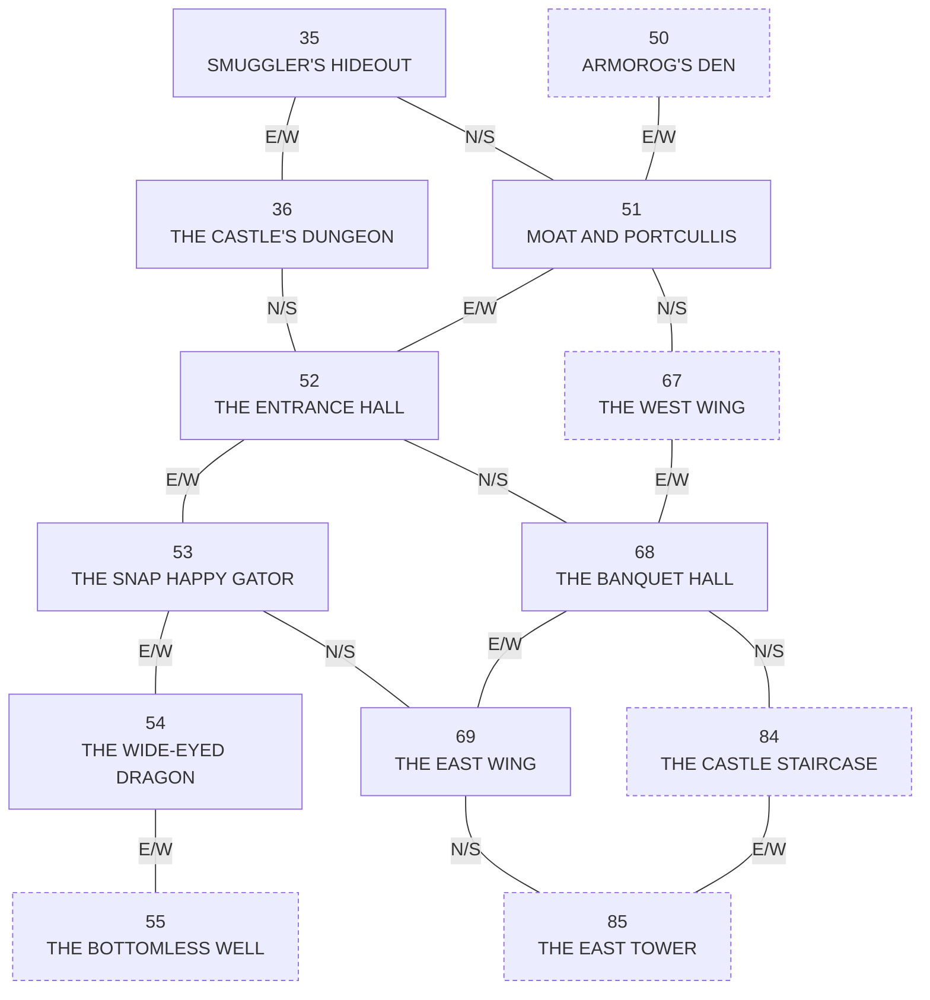

# Fantasy World Dizzy (ZX Spectrum, 1989) -- map

<!-- GENERATED by tools/roommap. Do not edit by hand; regenerate. -->

## The topology is a grid, not an exit table

There is no room-connection data anywhere in the original. Four routines ARE the map
(X-ALL.TXT ~6298):

| leaving | new room | and | 
|---|---|---|
| left edge | `roomno - 1` | x := 56 |
| right edge | `roomno + 1` | x := 2 |
| top edge | `roomno + 16` | y := y + 118 |
| bottom edge | `roomno - 16` | y := y - 114 |

then `and 127`. So **room = row x 16 + column**, **UP IS +16** (higher numbers are
higher in the world), and every room has four neighbours by arithmetic.

That means adjacency below is *arithmetic*, not *reachability*: whether you can walk
between two neighbours is decided entirely by the rooms' own art -- a wall drawn at the
screen edge is the only thing that stops you. Nothing in the data says which edges are
open, so this document never claims it.

## Rooms that are not places

These room numbers hold art, so they look like rooms in any extraction, but nothing
walks into them from a neighbour -- game code selects them directly. They are listed
here and left out of the world grid below.

| room | what it really is |
|---|---|
| 0 | the title screen |
| 1 | room 58 redrawn with the beanstalk grown (checkbeanstalk, X-ALL.TXT ~5478) |
| 2 | room 36 redrawn with the fire out (checkfireout, ~5491) -- this port builds it as the fire overlay |
| 3 | the heart demo shown on reaching Daisy (theheartdemo, ~3518) |

## The world

Rows are printed top-down, so up the page is up in the game.
**Bold** = built by this port. Blank = no room data at that number.

| row | +0 | +1 | +2 | +3 | +4 | +5 | +6 | +7 | +8 | +9 | +10 | +11 | +12 | +13 | +14 | +15 |
|---|---|---|---|---|---|---|---|---|---|---|---|---|---|---|---|---|
| **112** |  |  |  |  |  |  |  |  |  |  |  |  |  |  |  |  |
| **96** |  |  |  |  | 100 THE ATTIC |  |  |  |  |  |  |  |  |  |  |  |
| **80** |  |  |  | 83 THE WEST TOWER | 84 THE CASTLE STAIRCASE | 85 THE EAST TOWER | 86 THE LONGJUMP CLOUD | 87 THE MEETING HALL | 88 LIFT TO THE ELDERS | 89 DIZZY'S PARENTS HUT |  | 91 YET MORE CLOUDS | 92 MORE 'ORRIBLE CLOUDS | 93 THE CLOUD CASTLE | 94 DAISY'S PRISON |  |
| **64** |  |  |  | 67 THE WEST WING | **68 THE BANQUET HALL** | **69 THE EAST WING** |  | 71 KEEP OUT! DOZY'S HUT | 72 DENZIL'S PAD | 73 DAISY'S EMPTY HUT | 74 THE GIANT BEANSTALK | 75 COMPLEX CLOUD ROUTE | 76 NEAR THE VOLCANO TOP | 77 THE ACTIVE VOLCANO |  |  |
| **48** | 48 THE BROKEN BRIDGE | 49 THE GUARD HOUSE | 50 ARMOROG'S DEN | **51 MOAT AND PORTCULLIS** | **52 THE ENTRANCE HALL** | **53 THE SNAP HAPPY GATOR** | **54 THE WIDE-EYED DRAGON** | 55 THE BOTTOMLESS WELL | 56 THE LIFT CONTROL HUT | 57 BASE OF TREE HOUSE | 58 THE SMELLY ALLOTMENT | 59 THE LARGE OAK TREE | 60 BASE OF THE VOLCANO |  |  | 63 THE CRAFTY CLOUD |
| **32** |  |  |  | **35 SMUGGLER'S HIDEOUT** | **36 THE CASTLE'S DUNGEON** |  |  | 39 GOING DOWN THE WELL! | 40 THE DRAGON'S LAIR | 41 THE DESERTED MINES |  |  |  | 45 LOOKING OUT TO SEA | 46 THE DOCKS AND PIER | 47 FOURWAY WAREHOUSE |
| **16** |  |  |  |  |  |  | 22 THE MARKET SQUARE | 23 A STRANGE NEW WORLD! | 24 INSIDE THE CHURCH |  |  |  |  |  |  | 31 THE AMAZING ILLUSION |
| **0** | _0: not a place_ | _1: not a place_ | _2: not a place_ | _3: not a place_ |  |  |  |  |  |  |  |  |  |  |  |  |

## The built slice and its frontier

Solid boxes are built; dashed are the rooms one step outside it.

## Room index

| room | name | built | art | coins | actors | proximity triggers |
|---|---|---|---|---|---|---|
| 0 | the title screen |  | 51 |  |  |  |
| 1 | room 58 redrawn with the beanstalk grown (checkbeanstalk, X-ALL.TXT ~5478) |  | 12 |  |  |  |
| 2 | room 36 redrawn with the fire out (checkfireout, ~5491) -- this port builds it as the fire overlay | yes | 4 |  |  |  |
| 3 | the heart demo shown on reaching Daisy (theheartdemo, ~3518) |  | 2 |  |  |  |
| 22 | THE MARKET SQUARE |  | 78 | 1 | pickupable (shopkeeperhere), crowbar (shopkeeperhere1), pickupable (beanhere) | proxshopkeeper |
| 23 | A STRANGE NEW WORLD! |  | 75 |  |  |  |
| 24 | INSIDE THE CHURCH |  | 70 | 1 | pickupable |  |
| 31 | THE AMAZING ILLUSION |  | 105 | 1 |  |  |
| 35 | SMUGGLER'S HIDEOUT | yes | 56 |  | pickupable |  |
| 36 | THE CASTLE'S DUNGEON | yes | 63 | 1 | pickupable, pickupable, pickupable (loafhere), rat (rathere), troll (trollhere) | proxjug, proxloaf, proxtroll, proxapple |
| 39 | GOING DOWN THE WELL! |  | 42 |  |  |  |
| 40 | THE DRAGON'S LAIR |  | 67 | 1 | lift, dragon (dragonhere1), pickupable (goldenegghere1), pickupable | proxegg |
| 41 | THE DESERTED MINES |  | 70 | 1 | crowbar (rockhere), miner | proxpickaxe, proxminer |
| 45 | LOOKING OUT TO SEA |  | 25 |  | pickupable (sleepingpotionhere), pickupable (dozyhere), dozyfloat (dozyfloathere) |  |
| 46 | THE DOCKS AND PIER |  | 82 | 1 |  |  |
| 47 | FOURWAY WAREHOUSE |  | 99 |  |  |  |
| 48 | THE BROKEN BRIDGE |  | 39 |  | log, pickupable | proxrock |
| 49 | THE GUARD HOUSE |  | 42 | 1 | hawk |  |
| 50 | ARMOROG'S DEN |  | 54 |  | pickupable, armorog (armoroghere) |  |
| 51 | MOAT AND PORTCULLIS | yes | 63 | 1 | portcullis (porthere), portswitch |  |
| 52 | THE ENTRANCE HALL | yes | 91 | 1 | pickupable | proxpicture |
| 53 | THE SNAP HAPPY GATOR | yes | 33 |  | crocodile, pickupable, pickupable (whiskeyhere) | proxcroc |
| 54 | THE WIDE-EYED DRAGON | yes | 57 |  | dragon (dragonhere) | proxsleep |
| 55 | THE BOTTOMLESS WELL |  | 57 | 2 | pickupable, pickupable, pickupable, crowbar (welllidhere) | proxcrowbar |
| 56 | THE LIFT CONTROL HUT |  | 65 | 1 | machines, machines, machines, lift, machines, pickupable | proxkey1, proxkey2, proxkey3, proxkey4 |
| 57 | BASE OF TREE HOUSE |  | 79 | 1 |  |  |
| 58 | THE SMELLY ALLOTMENT |  | 45 |  | pickupable (manurehere), pickupable | proxfullbucket, proxbean |
| 59 | THE LARGE OAK TREE |  | 54 | 1 | pickupable, pickupable (dylanhere) |  |
| 60 | BASE OF THE VOLCANO |  | 55 |  | pickupable, pickupable | proxmtbucket |
| 63 | THE CRAFTY CLOUD |  | 7 | 1 |  |  |
| 67 | THE WEST WING |  | 55 | 1 |  |  |
| 68 | THE BANQUET HALL | yes | 76 | 1 | pickupable (ropehere), pickupable (denzilhere) |  |
| 69 | THE EAST WING | yes | 54 | 1 | dagger |  |
| 71 | KEEP OUT! DOZY'S HUT |  | 62 |  | lift |  |
| 72 | DENZIL'S PAD |  | 95 | 1 | pickupable, pickupable |  |
| 73 | DAISY'S EMPTY HUT |  | 74 | 1 | daisy1 (daisy1here), pickupable |  |
| 74 | THE GIANT BEANSTALK |  | 33 |  |  |  |
| 75 | COMPLEX CLOUD ROUTE |  | 37 | 1 |  |  |
| 76 | NEAR THE VOLCANO TOP |  | 24 | 1 |  |  |
| 77 | THE ACTIVE VOLCANO |  | 34 | 1 |  |  |
| 83 | THE WEST TOWER |  | 37 |  | pickupable (buckethere) |  |
| 84 | THE CASTLE STAIRCASE |  | 51 | 1 | door (doorhere) | proxdoor, proxknox |
| 85 | THE EAST TOWER |  | 36 |  | pickupable |  |
| 86 | THE LONGJUMP CLOUD |  | 7 | 1 |  |  |
| 87 | THE MEETING HALL |  | 68 | 1 | pickupable |  |
| 88 | LIFT TO THE ELDERS |  | 80 |  | lift, pickupable (doughere), pickupable (crowbarhere) |  |
| 89 | DIZZY'S PARENTS HUT |  | 62 | 1 | pickupable |  |
| 91 | YET MORE CLOUDS |  | 34 |  |  |  |
| 92 | MORE 'ORRIBLE CLOUDS |  | 34 | 1 |  |  |
| 93 | THE CLOUD CASTLE |  | 44 |  | pickupable (goldenegghere) |  |
| 94 | DAISY'S PRISON |  | 66 | 1 | dagger, dagger, crowbar (carpethere), crowbar (carpethere1), lift (daisylifthere), daisy (daisyhere), switch1 | proxrug |
| 100 | THE ATTIC |  | 78 |  | pickupable (bonehere) |  |
